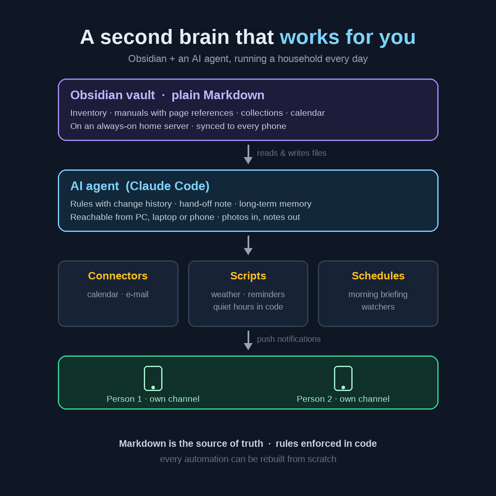

# 🧠 A second brain that works for you: Obsidian + an AI agent

**What happens when a personal knowledge base stops being something you *read* and becomes something an AI agent *works in* every day.**



This is a write-up of a system I designed and run for a household of two: an Obsidian vault of plain Markdown files, a Claude Code agent that reads and maintains it, a handful of small scripts, scheduled tasks, and push notifications to our phones. It has been in daily use for weeks. The real vault stays private; this repository contains the method, a **starter vault with invented example data**, and the notification script with quiet hours enforced in code.

---

## The idea in one paragraph

Most "second brains" are archives: you put notes in, and on a good day you find them again. Here the vault is the **shared memory between a person and an AI agent**. You say, in your own words and messily, *"add the new router to the inventory"*, *"remind me tomorrow at three to call the garage"*, *"what's the tyre pressure on the car?"*. The agent decides where things go, keeps the structure consistent, answers from the documents and pushes what matters to your phone at the right moment. You never organise anything by hand, and nothing lives in an app you can't read without it.

---

## Architecture

```
          ┌──────────────────────────────────────────────┐
          │  Obsidian vault  (plain Markdown + YAML)      │
          │  synced to every phone and computer          │
          │  (Syncthing, no cloud account needed)         │
          └───────────────┬──────────────────────────────┘
                          │ reads / writes files
          ┌───────────────▼──────────────────────────────┐
          │  AI agent (Claude Code)                       │
          │  · instructions file  · vault rules           │
          │  · hand-off note      · long-term memory      │
          └──┬──────────────┬───────────────┬────────────┘
             │              │               │
   connectors│      scripts │     scheduled │ tasks
   (calendar,│   (notify,   │   (morning    │ report,
    e-mail)  │    weather)  │    watchers)  │
             └──────────────┴───────┬───────┘
                                    ▼
                         push notifications (ntfy)
                         on each person's phone
```

Everything the agent knows is in files you can open in any text editor. Everything it does on a schedule is a short script you can read.

---

## Talk to it from anywhere

The vault lives on an **always-on machine at home**: in my case a small NAS, which also keeps the backups. The agent works directly on those files, so the same conversation can continue **from the desktop, the laptop or the phone app**, and every device sees the same, up-to-date vault.

- **With a NAS (or any always-on home server):** the vault and the agent's working environment stay at home; you connect from wherever you are.
- **Without a NAS:** any computer that stays on will do, reached from outside through a **private VPN** (Tailscale or WireGuard). Nothing has to be exposed to the internet.
- **Offline reading:** the vault is also synced to the phones (Syncthing), so the notes are there even without a connection; the agent is needed only to change things.

## Photos as input

The phone camera is the fastest way to feed the system:

- **A shelf of books:** photograph the spines, and the agent creates a note for each book (**dozens in one go**), with author, publisher, series and collection, links each one to its author's note and updates the collection tables, including which volumes are still missing.
- **Labels and stickers:** a photo of a device's label becomes an inventory note with brand, model, product code and serial number, without retyping anything.
- **Receipts and warranty certificates:** the purchase date and warranty end go into properties, and the deadline into the calendar.
- **Board games, screens, documents:** anything you can photograph can be read, summarised and filed.

You review what was added; the agent never invents what it could not read (the field stays empty and is listed as "to be completed").

---

## The building blocks

### 1. A short instructions file
The agent reads one small file at the start of every session (`CLAUDE.md`). It does not contain knowledge, only **pointers and non-negotiables**: where the rules are, where the hand-off note is, which areas have their own mandatory rules, the language to answer in, and a few hard limits (*never invent personal data; no passwords in the vault; no notifications during quiet hours*).

### 2. Vault rules, with a change history
One note describes the structure: which folder holds what, how notes are named, which properties each kind of note has. Every structural change is appended to a **dated history** at the bottom. When the agent meets a new kind of information, it proposes a rule, applies it and records it. Months later you can still see *why* things are where they are.

### 3. A hand-off note between sessions
AI sessions end; the work doesn't. A single note answers *"where did we leave off?"*: what is running, what is open, what is waiting for an answer. The agent reads it at the start of a new conversation and **rewrites** it (not appends to it) at the end of a long one, so it stays short and true.

### 4. Long-term memory, one fact per file
Separate from the vault, the agent keeps small memory files: one fact each (a preference, a correction, a pointer), with a one-line index loaded every session. *"Answers must be short."* *"This person's calendar is shared with write access."* *"Large PDFs: extract the text with page markers."* Wrong memories are deleted, not left to rot.

### 5. Knowledge areas
- **Inventory:** one note per object with structured properties (brand, model, serial, warranty end, location, owner) and **database views** built with Obsidian Bases: everything under warranty, every disk, everything waiting for a repair.
- **Manuals:** PDFs stored next to the object's note, with the **text extracted alongside, marked page by page**. Questions are answered from the manual, **citing the page**; frequently needed answers (tyre pressures, error codes, maintenance intervals) are copied into the note itself.
- **Collections:** books, board games, video games, linked to their authors and designers, so the graph view shows real connections.
- **Journal, anniversaries, name days:** one note per event, one table per month.
- **IT documentation** for several sites, with its own mandatory rules (what is off-limits, what needs a human's explicit go-ahead), its own work list and a monthly clean-up routine.
- **An "urgent" list** that the agent reads out when asked *"what do I have to do?"* and that also feeds the morning report.

---

## What it does every day

- **A morning briefing at a fixed time, per person, on each phone:** weather warnings, current conditions from the national weather service (with fallback stations), the day's forecast, sunrise and sunset, today's and tomorrow's calendar, birthdays in the coming week and, for one of us, deadlines and the to-do list.
- **Reminders in plain language:** *"remind me at 15:00 to…"* becomes a scheduled push notification within the next three days, or a calendar event if it is further away.
- **Quiet hours, enforced in code:** no notifications on Sunday mornings or at night. The notification script itself refuses those times, so the rule holds even if the agent forgets it.
- **A calendar that maintains itself:** feast days, fasting periods and the days when fasting is lifted are **computed from the date of Orthodox Easter** for the next ten years, written as recurrence rules, with a reminder to extend them before they run out. Birthdays notify at a safe morning hour.
- **Deadlines that can't be missed:** car insurance, inspection, road tax, warranties; each is a property on its note and two calendar events, two weeks before and on the day, in both calendars.
- **Watchers:** for example, a task that checks the mailbox twice a day for replies to a job application and sends a push notification only when something arrives.
- **Photos in, structured notes out:** a picture of a bookshelf, a device label or a receipt becomes notes, properties and calendar deadlines (see *Photos as input*).
- **Answers from your own data:** *"which disks are in the NAS?"*, *"when does the boiler need its inspection?"*, *"what did we decide about the backup?"*.

---

## Design principles

These are the parts I would keep in any version of this system.

1. **Markdown is the single source of truth.** Readable without the agent, synced without a vendor, diffable, and still useful if every AI service disappeared tomorrow.
2. **Rules that matter are enforced in code.** Instructions to a model are wishes; a script that refuses a forbidden hour is a guarantee.
3. **Every automation can be rebuilt from scratch.** Each one has a note with the full script and a numbered "rebuild" section. The cloud environment is disposable; the knowledge isn't.
4. **Never invent.** If a price, date or serial number is unknown, the field stays empty or says "to be completed". A wrong value is worse than a missing one.
5. **No secrets in the vault.** Passwords and keys live in a password manager. The one documented exception is written down with the reason and with what to do if it leaks.
6. **Humans approve what can't be undone.** The agent works in a sandbox; deleting folders, touching production systems at a workplace or anything outward-facing needs an explicit go-ahead, step by step.
7. **One channel per job.** All alerts come from one notification service; the calendar app's own notifications are switched off. Two sources of the same alert train people to ignore both.
8. **Short notes that stay true.** Hand-off notes are rewritten, work lists lose finished items, logs older than a month are compressed into one line per subject.

---

## Things that went wrong, and what fixed them

- **The morning report arrived late or not at all on one phone.** The push app was receiving messages through the phone vendor's battery-optimised channel. Fix: the app's *instant delivery* setting and an unrestricted battery profile, now part of the "new phone" checklist.
- **Duplicate alerts** from the calendar app and from the push service. Fix: principle 7; notifications are generated from the calendar but delivered only by push.
- **Scheduled cloud tasks couldn't read e-mail.** A scheduled task only inherits the connectors of the session that created it. Fix: create such tasks from a session that already has the connector, and make the task report clearly when access is missing instead of failing silently.
- **The agent forgot yesterday's decisions.** Fix: the hand-off note and one-fact memory files.
- **Structure drifted** as new kinds of things arrived. Fix: the rules note with its dated history; the agent reads it before any change.
- **Scanned manuals were unsearchable.** Fix: transcribe once (page by page, one language), keep the text next to the PDF, answer with page numbers.

---

## What's in this repository

```
vault-template/            a starter vault with invented example data
  CLAUDE.md                the agent's instructions file
  Home.md · Urgent.md      start page and the to-do list
  00 Agent/
    Vault rules.md         structure, names, properties + dated change history
    Handoff.md             "where did we leave off?"
    Notifications.md       how reminders work, and how to rebuild them
  Inventory/               object notes with properties + Inventory.base (saved views)
  Library/                 a book note linked to its author note
  Journal/                 one note per event
  Templates/               Object, Book, Journal
  Attachments/Manuals/     where manuals and their extracted text go
memory-example/            the agent's long-term memory: an index + one fact per file
scripts/ntfy-send          push notifications with quiet hours enforced in code
docs/diagram.png
```

### Use it

1. Copy `vault-template/` somewhere synced to your devices and open it in Obsidian.
2. Point Claude Code (or another agent) at that folder; it will read `CLAUDE.md` first.
3. Put `scripts/ntfy-send` where the agent can run it, set `NTFY_TOPIC` (and `NTFY_TZ`), subscribe to the same topic in the ntfy app, and send a test:
   ```bash
   NTFY_TOPIC=your-private-topic ./scripts/ntfy-send "It works" --title "Test"
   ```
   Change the quiet hours at the top of the script. `NTFY_DRY_RUN=1` shows what would be sent without sending it.
4. Replace the example notes with your own, by talking to the agent: *"add my router, here's a photo of the label"*.

---

## Build your own

1. **Start with the vault**, not the AI: a few folders, one template per kind of note, a rules note. Sync it to your phone.
2. **Write the instructions file:** pointers to the rules and the hand-off note, the answer language, your hard limits.
3. **Add one notification script** that enforces your quiet hours, and test it.
4. **Add one daily report.** Start with weather and today's calendar; grow it only when you miss something.
5. **Make every automation rebuildable:** script in the note, numbered steps.
6. **Let the agent do the filing.** Speak naturally; correct it when it gets something wrong, and let the correction become a rule.

---

## What this shows

- **Context engineering:** giving an agent durable memory, rules and hand-off discipline so it stays useful across hundreds of sessions.
- **Reliability over cleverness:** guardrails in code, idempotent scheduled jobs, rebuild procedures, honest failure messages.
- **Product thinking for a tiny user base:** two people with different needs, separate channels, one shared truth.
- **Practical infrastructure:** an always-on home server or a private VPN, file sync to phones, and an agent you can reach from any device.

---

*Built with Obsidian, Claude Code, a few Node and Python scripts, ntfy, Syncthing and a home NAS reachable over a private VPN. The vault is private; the method is free to copy.*

## Author

Mihai Mereu · [GitHub](https://github.com/mmereu97)
